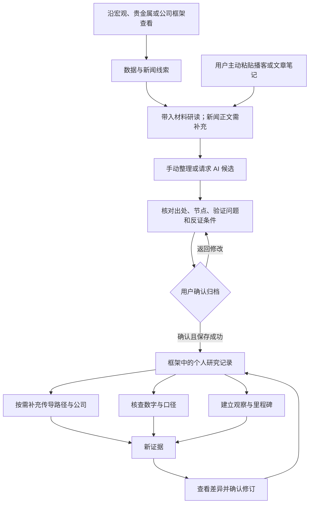

# 观澜 · 产品需求文档 v0.2

> 将日常资讯与碎片知识，沉淀为有出处、可核查、可修订的个人投研记录。

| 项目 | 内容 |
|---|---|
| 文档状态 | **阶段性需求基线，待评审**；已确认的产品方向与规则先行，未决事项单列 |
| 产品基线 | v0.8 本地单用户工作台；尚未公开部署、尚未完成真人用户验证 |
| 更新日期 | 2026-10-12 |
| 文档维护 | 项目负责人维护；AI 辅助整理，外部候选结果需复核后采用 |
| 适用读者 | 产品、设计、开发、测试及产品使用者 |
| 本版目的 | 明确为什么做、做什么、交互与数据规则、如何验收；不以功能存在代替质量验收 |
| 前序文档 | [PRD v0.1](PRD-v0.1.md)保留为历史草稿；本版对同一需求的描述优先 |
| 操作指南 | [综合说明书 v0.7](全功能使用说明书-v0.7.md) + [行情补充 v0.8](真实行情实操-v0.8.md) |

## 1. 修订记录与编写依据

| 日期 | 版本 | 变更 |
|---|---|---|
| 2026-10-12 | v0.2 | 根据已确认需求、v0.8 实现及既有操作记录重写；建立功能编号、异常规则、验收与待决清单；保留 v0.1 |

结构参考用户提供的《噗啦啦的新手产品经理PRD模板》：需求背景、需求列表、页面与交互、非功能需求、相关方及里程碑。模板中的业务案例、满意度数据和排期不适用于本产品，未沿用。针对本产品补充数据口径、AI 确认机制、可追溯性与发布门槛。

证据优先级：用户明确确认的需求 → 当前主目录实现与已有验收记录 → 外部审查的候选结论 → 尚待验证的产品假设。外部回传已出现，但补丁及测试未由本项目负责人合并复跑，不能据此宣布修复完成。本文编写过程中没有调用真实模型或开展新一轮用户测试。

状态说明：**已有基线**指有实现及既有正常流程证据，不代表所有异常已通过；**部分验证**指仅部分来源或条件验证；**模拟验证**不代表真实模型效果；**待复核／修复**指已收到问题报告但本地结论未闭环；**待决**不构成交付承诺。优先级与实现状态分开：P0 为核心链路或发布阻断项，P1 为增强项。

## 2. 需求背景、用户与目标

### 2.1 用户问题

目标用户有一定金融基础，经常听播客、阅读深度文章，但研究方法和记录较零散；可能只知道想研究股票，并没有明确公司。用户需要把内容放到已有研究问题下，知道接下来查什么，并在新证据出现时更新判断。

当前依据主要来自发起者自述与真实材料演练，尚不足以证明问题的普遍程度、市场规模或付费意愿。

| 用户困难 | 已有依据 | 产品应接住的结果 |
|---|---|---|
| 听懂一个框架，但不知道如何应用 | 从优势、仓位等抽象方法难以落到研究对象 | 给出固定研究问题、观察项及反证入口 |
| 笔记越积越多，难以找到与自己相关的内容 | 用户明确提出不应完全依赖播客拼凑方法论 | 先有宏观—行业—公司骨架，再将材料归入节点 |
| 知道一个趋势，却不清楚影响谁 | 用户提出 AI 前沿通过产业链影响上市公司的例子 | 记录传导条件、候选公司的产业位置和研究理由 |
| 数字、口径与推论混在一起 | EP.02 纪要存在时间窗、取整和指标定义问题 | 数值核对与口径判断分开，允许保留待核实 |
| 记录了判断，却不会持续复核 | 用户提出叙事级观察与里程碑 | 把判断转为可追踪问题，保留后续证据和修订理由 |

### 2.2 产品定位与范围取舍

观澜是有框架的个人研究工作台。用户既可沿固定框架查看数据与信息，也可主动带入材料；两条路径最终汇合到自己的研究记录。

首个行业聚焦黄金、白银及 A 股贵金属相关公司。宏观解释研究环境，行业解释供需与产业角色，公司解释经营、估值和价格表现，叙事贯穿其间。汽车与电池案例用于验证跨层传导及公司关联，**不意味着首版已建设完整汽车、电池行业模块**。

一个用户可以只归档观点、只核查数字或只建立观察。公司关联和观察不是所有材料的必填终点，不能为了“走完流程”强迫用户选择股票。

### 2.3 目标与效果评估

产品目标是让用户从“读过”前进一步，形成可追溯、可继续研究的记录。下列效果均为待验证假设，不填入未经测量的提升比例。

| 编号 | 假设／指标 | 统计口径与验证方式 | 当前状态 |
|---|---|---|---|
| M01 | 用户能独立完成核心任务 | 按归档、核查、公司关联、观察、修订分别统计：无帮助完成数／尝试数；记录阻塞点 | 待真人测试 |
| M02 | 记录足以支持下一步研究 | 抽查归档记录：出处可定位、验证问题具体、反证条件可理解，三项均通过的比例 | 已有案例；未形成样本基线 |
| M03 | 沉淀后会继续使用 | 经同意后观察 14 天内新增核查、关联或复核的记录比例；如现有时间戳不足，以前后备份和测试日志记录，不推算 | 待验证，未上线埋点 |
| M04 | AI 减少整理负担且保持归因准确 | 同一批材料人工与 AI 辅助对照：完成时间、改写量、引用错误、无依据扩写 | 真实模型未评测 |
| M05 | 数据获取可理解、可恢复 | 按来源与请求分别记录新获取、同日缓存、旧缓存、失败及耗时；不合并为一个“成功率” | 部分真实来源记录 |

建议先做 3—5 位目标用户的形成性试用，发现流程问题；该小样本不能用于宣称市场验证。目标值和扩大试用条件在首轮基线完成后确定。交易收益不作为产品效果指标。

## 3. 范围与需求列表

### 3.1 首版范围

覆盖本地单用户、文字材料、固定框架、公开数据及有限公司样本、人工确认归档、研究链路、持续观察、修订与 JSON 备份。AI 是可选整理助手；未配置时人工主流程仍可完成。

本版不承诺：全市场金融终端、实时交易行情、自动买卖建议或仓位计算、预测收益、股票综合排名、自动证明因果、自动判定叙事成立、多人协作、云端同步、音频转写、公众号或播客评论区自动抓取。Markdown 研究导出、原文统一去重存储、自动比较新旧材料属于后续候选，不能写成已交付。

### 3.2 功能需求总表

| 编号 | 模块／需求 | 本轮性质 | 优先级 | v0.8 状态 |
|---|---|---|---|---|
| R01 | 固定框架、产业链角色与来源说明 | 确认基线 | P0 | 已有基线 |
| R02 | 数据与新闻按节点查看、来源状态可见 | 确认及补充异常验收 | P0 | 部分真实来源验证 |
| R03 | 文字导入、分段与原文定位 | 确认基线 | P0 | 已有真实材料案例 |
| R04 | 手动拆解、预览、逐条确认归档 | 确认及可靠性修复 | P0 | 正常流程已有基线；保存失败待复核 |
| R05 | AI 候选、引文校验与人工确认 | 补充真实评测及修复 | P0（AI 开放前） | 模拟验证；真实效果未验收 |
| R06 | 关注词排序与研究线索入口 | 确认基线 | P1 | 关键词匹配，非语义推荐 |
| R07 | 传导路径、公司关联与来源回溯 | 确认基线 | P0 | 已有基线 |
| R08 | 核查项、同期缓存对照与核查历史 | 确认基线 | P0 | 已有基线 |
| R09 | 公司财务、人工估值及横向比较 | 确认口径 | P0 | 五个财务样本；估值手填 |
| R10 | CSV 技术指标及公开历史价格 | 补齐真实来源稳定性 | P1 | CSV 已验证；日线部分验证 |
| R11 | 观察主题、里程碑、新闻匹配与复核 | 确认基线及补齐复核规则 | P0 | 页面内可用；延期闭环待完善 |
| R12 | 观点修订、差异确认与历史 | 确认及可靠性修复 | P0 | 正常流程已有基线；保存失败待复核 |
| R13 | 本地保存、备份导出与合并 | 修复与异常验收 | P0 | 正常流程已有基线；异常和导入安全待复核 |
| R14 | 离线体验与能力状态提示 | 确认基线 | P0 | 独立 HTML 可用；不等于线上部署 |
| R15 | 自动指标规则、站外通知 | 需求待决 | P1 | 未承诺实现方案 |
| R16 | 公开部署与访问控制 | 方案待决 | P0（公开前） | 未部署 |

## 4. 页面结构与用户流程

### 4.1 页面清单

| 页面 | 用户要回答的问题 | 主要内容与下一步 | 原型／规则定位 |
|---|---|---|---|
| 首页 | 从哪里开始？ | 功能状态、材料归档入口、当前研究概览 | 综合说明书 §2 |
| 我的研究线索 | 哪些已存观点与我有关？ | 关注词、排序后的观点、研究链路入口 | R06 |
| 宏观 | 环境如何变化？ | 增长、通胀、政策、货币金融；框架、数据、相关信息、我的证据 | R01、R02 |
| 贵金属 | 品类如何受影响？ | 黄金／白银研究问题、产业链角色、价格与供需线索 | R01、R02 |
| 公司与业务 | 为什么研究这家公司？ | 个人公司、来源观点、经营框架、财务、估值、技术比较 | R07、R09、R10 |
| 叙事观察 | 什么证据会改变判断？ | 模板预览、我的观察、里程碑、新闻匹配与复核 | R11 |
| 材料研读 | 这段内容如何进入我的框架？ | 导入 → 拆解与归类 → 确认归档 | R03—R05 |
| 设置／来源与备份 | 数据从哪里来，记录如何保存？ | 来源开关及状态、备份导出和合并、能力提示 | R02、R13、R14 |

现有可操作原型：[本地启动入口](../prototype/启动原型.command)、[独立 HTML](../prototype/观澜-可交互原型.html)。截图见综合说明书及场景说明书。本版复用已存在的页面，不以新绘制的页面冒充已实现界面。

### 4.2 主流程

### 4.3 四种核心动线及完成标准

| 场景 | 路径 | 最小完成标准 |
|---|---|---|
| 留住有用观点 | 导入 → 定位原文 → 归类 → 确认 | 在对应节点找到观点，能回到原文并说明下一步问题 |
| 理解影响对象 | 观点 → 研究链路 → 条件路径 → 公司关联 | 公司有产业位置、理由及来源；没有合适公司时允许为空 |
| 判断依据 | 观点 → 核查项 → 同期数据或原始资料 → 补充依据 | 期间、单位、来源和状态可查；不确定性被保留 |
| 持续关注 | 观点／模板 → 观察 → 里程碑 → 新证据 → 复核／修订 | 用户能看到为什么改变判断；单纯到期不等于假设成立 |

已用 EP.02 真实纪要形成六条观点、三家公司、八项核查和三个观察主题，见[场景说明书](场景式说明书-十分吸引EP02.md)。这是流程案例，不等于 AI 自动完成，也不等于独立用户成功率。

## 5. 功能需求详述

### 5.1 R01—R02：框架、数据与新闻

**操作者／前置条件：** 本地用户无需登录；框架离线可读，刷新公开来源需启动服务并能访问上游。

- 框架节点提供核心问题、分析路径、观察项、重新判断条件及方法来源。行业链条区分生产角色与持有／交易参与者，不能由角色直接推导“必然受益”。
- 每个节点可查看对应数据、相关信息与个人证据；缺少指标时明确显示未接入或无数据，禁止填充示例值。
- 数据展示观察期、单位、来源和获取时间；抓取时间不能替代数据观察期。失败有旧值时显示旧缓存及失败状态，无旧值则显示不可用。
- 新闻可按范围、来源、关键词筛选。带入研读仅预填标题和链接，不声称已抓取文章全文；正文由用户补充。来源关闭后不应继续贡献主动匹配结果。
- 本地服务运行期间按自然日检查公开源更新；关闭后停止。年度供需摘要为人工整理内容，不随刷新自动更新。
- 带入年度摘要等操作将替换现有非空草稿时，必须先确认，取消则保留草稿。轮询更新不得打断用户输入；这一异常场景收到外部问题报告，待复核修复。

**验收：** 正常、旧缓存、无缓存失败分别可区分；用户能找到来源和观察期；新闻导入不伪造正文；取消替换不改变草稿。

### 5.2 R03—R04：材料导入与确认归档

**前置条件：** 浏览器存储可用。允许粘贴文字或导入 UTF-8 TXT／Markdown，不直接解析 PDF、音频或网址全文。

| 字段／规则 | 要求 |
|---|---|
| 标题、类型、正文 | 标题和正文必填，类型从预设项选择；标题最多 160 字符；正文按空行分段，最多 50,000 字符，文件最多 200 KB |
| 来源链接 | 可选，须为 HTTP／HTTPS 地址，仅作为出处；不因填写 URL 自动下载内容 |
| 依据段落 | 从当前材料的有效段落选择；必须展示所选原文 |
| 观点 | 每条聚焦一个判断，最多 2,000 字符；区分作者说法与自己的推论 |
| 框架节点、证据作用 | 从现有节点与作用选项选择，不自动改写框架底座 |
| 验证问题、反证条件 | 均需填写，分别最多 1,200 字符；建议具体到对象、期间或可观察事件 |
| 同时观察 | 可选；选中时必须填写新闻匹配关键词，最多 250 字符 |

步骤：校验导入 → 选择段落并填写观点 → 展示归档节点、原文、问题与反证 → 用户确认 → 保存成功后提供“查看框架证据／继续整理同一材料”。未确认不新增正式观点。

纪要时间戳根据文本中的时间标记辅助识别，允许修正；不标为已经回听音频核验。一个来源允许产生多条观点；当前重复判断针对相同标题、正文、观点及节点，不是全局语义去重。

**异常与验收：** 超限或编码错误应说明原因；缺项时留在编辑步骤；保存失败不得显示已归档、不得在内存中留下伪成功记录。刷新后原文、观点和关联仍存在才算保存成功。存储失败部分目前列为待复核／修复。

### 5.3 R05：AI 辅助拆解

**触发与输入：** 用户主动点击；配置可用时发送当前材料及固定节点信息到指定模型服务商，不发送其他研究记录。未配置、离线或请求中应有明确按钮状态，手动整理仍可用。材料正文作为不可信待分析内容，不作为系统执行指令。

**输出协议：** 返回 1—5 条候选，每条包含节点、段落号、逐字引文、观点、验证问题、反证条件、新闻关键词。服务端校验结构、长度、有效节点、段落范围和引文是否在指定段落内；任一候选不合格则不采用该批结果。结构合格与引用存在都不证明观点正确。

**人工确认规则：** 候选只填入待审草稿，用户逐条选择、改写和归档。禁止无依据补数字、公司、因果或交易建议。当前“事实／作者观点／推测”主要靠文案表达，尚无独立类型字段及自动真实性判定。

**异常规则：** 连接失败、超时、协议不兼容均保留人工草稿，不自动重试收费请求。请求等待期间用户修改正文、标题或研究字段，旧响应不得覆盖新输入；仅保留候选供主动选择。改选段落或改写观点后，必须重新判定引用标签，不能沿用不适用的“已校验”。后两项已有外部问题报告，尚未闭环。

**验收门槛：** 伪造引文、错误段落、未知节点、材料中的恶意指令、错误归因、过短无意义引文、迟到响应及手动改写均需覆盖。真实评测记录模型版本、材料版本、人工评分、耗时与费用；引文最短长度、质量阈值和成本上限见 D02，不能凭模拟用例宣称通过。

### 5.4 R06—R07：研究线索、传导路径与公司

用户在“我的研究线索”设置关注词，系统按关键词及已关联公司信息排序；未匹配记录保留。这里不读取用户实际持仓，不保证语义相关性。

从观点打开研究链路，可逐项保存传导路径，当前最多 12 项。每一步应保留必要条件，如库存滞后、议价能力或成本传递；路径是待验证假设。

公司可新建或关联已有记录，填写名称、六位代码、产业位置、研究理由与待验证内容。公司列表应可回溯来源观点。手工名称与代码不等于证券身份已验证，不能自动把研究者添加的公司归因为播客作者提及。新增公司会检查重复代码；跨备份合并后的同代码冲突尚待确定规则。

**验收：** 从观点到公司再返回原观点可走通；不选择公司不阻断归档；研究者新增样本保留其归属与理由。

### 5.5 R08：核查与修订核查依据

每条观点可添加核查项：问题、材料值、单位、观察期、数据序列、来源链接、状态、判断理由与历史。可选已接入的序列按同期间对照缓存，不能用最新值替换历史期间。

| 对照结果 | 应展示的含义 |
|---|---|
| 同期数值对得上 | 缓存数值一致，仍需核对定义、期间和统计口径 |
| 数值不同 | 待解释；可能是取整、盘中／日终或窗口不同，不能自动判假 |
| 无同期间观测 | 缺少同期间数据，保留待核查 |
| 缺定义或公式 | 不自动计算、不据此生成行业名单；列明缺少的资料 |

修改同一核查项须保留旧值、旧状态、理由与时间。修改输入后不得继续沿用已失效的对照结论。人工核验与缓存对照状态分开表达。

**验收：** 覆盖相等、不同、单位不符、缺期间及非数值；修订后能查到旧依据。EP.02 的“传导指数”缺公式，应停留在缺定义，而不是生成指数排名。

### 5.6 R09：公司财务与估值比较

公开财务当前限定山东黄金、盛达资源、宁德时代、比亚迪、亿纬锂能五个样本，支持贵金属样本、个人公司及全部样本范围和报告期筛选。未支持的个人代码明确列为缺口，不能用其他公司替代。

展示营收、归母净利润、扣非净利润、毛利率、ROE、资产负债率、每股经营现金流。营收、利润与每股经营现金流为年内累计口径，资产负债率为期末口径，ROE 不在平台擅自年化。同报告期不等于业务可比；分部收入、AISC、产销量、资本开支和完整三表尚未覆盖。

估值快照由用户录入 PE(TTM) 和／或 PB，至少一个有限数值，同时保存估值日、财报截止期、币种及来源。财报期不得晚于估值日，日期不得在未来。比较须提示日期、报告期与币种是否一致；不把负 PE 解释为低估。

**验收：** 缺值显示空缺；不同日期或报告期可识别；不以单一倍数输出结论。覆盖旧快照时保留历史；目前历史在备份内保留，尚无专门浏览页面。

### 5.7 R10：历史价格与技术指标

两种输入：用户导入 CSV，或在允许的五个样本内请求公开历史日线。输出 MA20、RSI14、MACD(12,26,9)；Hist 为 MACD−Signal，不乘 2，数据不足留空。

- CSV：UTF-8、最多 500 KB、1—5,000 行，含 `date,close`；日期合法且不重复、非未来，价格有限且为正；按日期排序计算。复权选项仅标注输入口径，不替文件进行复权。
- 公开日线：限制代码、复权方式及日期；窗口最多 730 天、结束日早于当天。先显示预览、来源、请求／实际窗口、获取时间及缓存状态，确认前不更新公司结果，可取消或下载 CSV。
- 同日精确口径缓存可复用；强制更新失败只允许回退同代码、同窗口、同复权缓存，并保留原获取时间。无缓存则报错，不破坏旧研究结果。
- 比较需要考虑截止日、复权、币种、起始窗口、缺失交易日与来源。当前界面校验未完整覆盖后几项；不能仅因截止日相同就宣称技术序列完全可比。

**当前证据：** 宁德时代、亿纬锂能各 183 条真实日线获取成功，浏览器流程使用同日真实缓存并完成复算；比亚迪、山东黄金有连接失败记录，盛达资源该轮未实测。五个代码“允许请求”不等于五个都稳定接通。

**验收：** 预览取消不保存、确认后刷新保留、CSV 重算一致；失败不污染旧值；缺失、非正价格、重复日期、窗口和证券身份检查需纳入补充验收。公开来源稳定性依赖 D01。

### 5.8 R11、R15：叙事观察与提醒

用户可以从观点建立观察，也可预览四个研究模板、两个历史方法案例后主动采用。预览不新增个人主题，模板不是当前市场结论。

观察保留标题、关联节点、验证问题、反证条件、新闻关键词，可关联原观点。支持编辑、暂停、恢复与新闻标记已读；暂停主题不计主动命中。关键词只匹配已启用来源的新闻标题，无命中不表示事件没有发生。

里程碑包含标题、判断条件、复核日期、状态、依据及历史。状态为“待核查／出现支持线索／出现反证／延期”；变更状态需要填写依据。当前页面仅对观察中的待核查且日期已到项目提示复核，不在用户关闭页面后推送。

**应补齐的规则：** 延期须形成下一次复核安排，否则可能不再提示；何时允许重新进入待核查、是否要求新的复核日，见 D03。数值阈值触发与人工叙事判断分开；外部事件没有可靠指标时不自动宣称“出现反证”。

**验收：** 模板采用、新闻匹配、已读、暂停／恢复、状态更新及历史可走通；日期到期只提示复核，不改写结论。自动指标规则和站外通知须另行评审。

### 5.9 R12：观点修订

用户打开既有观点，填写修改后的观点、证据作用及修改理由；展示前后差异，确认后版本递增。空理由、无变化不产生新版本；打开修订后版本已经变化则拒绝覆盖。

原始出处保持，新增证据可另行导入。关联观察保留原假设，界面提示可单独修订，不自动把旧观察的历史改成新判断。

**验收：** 查看差异后取消不改记录；确认后刷新仍是新版本并保留旧观点、理由和时间；持久化失败时回滚且不显示成功。最后一项待补充异常验收。

### 5.10 R13—R14：本地保存、备份及离线状态

研究记录存当前浏览器 localStorage；服务端缓存公开数据，不提供个人云端账户。不同来源地址的浏览器存储不共享，清理浏览器数据可能移除记录。

JSON 导出包含原文、草稿及个人研究，应提示本地保管。导入仅接受 schema=2、文件小于 5 MB，先校验再合并：相同 ID 保留当前记录，不按最大版本自动覆盖；草稿不合并。重复导入同一备份不得新增同 ID 记录。这不是完整同步或全量恢复。

**必须满足：** 数据校验失败不改当前记录；写入失败时内存与持久化保持一致；所有导入字段作为文本处理，不执行脚本。存储不足、损坏存储恢复及备份字段安全已有审查问题，待复核／修复。同代码不同 ID 的公司如何合并见 D05。

独立 HTML 可查看公开快照、整理及备份；AI、公开数据刷新、技术指标计算不可用时明确提示需本地服务。展示快照日期，不能标成实时行情。

## 6. 数据、方法与关联关系

### 6.1 核心对象

| 对象 | 最小信息 | 关联与保留规则 |
|---|---|---|
| 研究记录 Entry | 原文、标题、段落、节点、观点、问题、反证、模式、版本及历史 | 可有传导路径、核查项；原文当前随每条记录保存，存在重复占用空间 |
| 核查项 Check | 材料值、单位、期间、序列、状态、来源与依据 | 从属于研究记录；修订保留历史 |
| 公司 Company | 名称、代码、产业角色、研究理由 | 可关联多个来源记录；保留估值及技术快照 |
| 观察 Watch | 节点、问题、反证、关键词、启用状态 | 可关联原记录；下含里程碑、已读新闻及复核历史 |
| 公开来源 Source | 来源身份、观测值／新闻／财报、状态及抓取时间 | 与个人观点分离；失败不伪装成功 |
| 价格缓存 | 证券代码、区间、复权、实际数据、来源和时间 | 按完整口径区分；用户确认才写入公司研究 |

当前没有独立、去重的原文库，也没有自动冲突解决引擎。若改为原文单独保存，应新增迁移方案，确保旧备份可读、引用和历史不丢失。

### 6.2 来源与口径边界

| 数据／方法 | 已有来源或能力 | 必须说明的边界 |
|---|---|---|
| 国内宏观 | 公开来源经 AKShare 接入 PMI、CPI/PPI、M2、社融增量、LPR 等 | 发布时间与观察期不同；时滞随来源变化，不保证每日都有新值 |
| 美国利率等 | FRED 名义／实际利率、盈亏平衡通胀及美元相关序列 | 名义与实际、盘中与日终不能混用；各序列状态独立 |
| 金银及持仓 | 上金所价格、GLD／SLV 持有量、人工年度摘要 | 黄金元／克与白银元／千克不同；单只 ETF 不代表市场总持仓 |
| 新闻 | 财联社、新浪、东方财富、固定公司样本与美联储 RSS 等 | 非全网；BLS RSS 已有失败记录；不承诺全文转载或自动验证真实性 |
| 方法底座 | 用户提供的宏观及贵金属框架、书籍阅读整理稿 | 《穿透估值》《穿透叙事》阅读稿为二手整理，未全部直接核验原书；不作为原书认证 |
| 成熟组件 | AKShare、feedparser、TA-Lib | 明确复用；开源代码许可证不等于金融数据再分发授权 |
| 既有底座验证 | Open Notebook 接口 PoC | 当前工作台未与其存储集成，不描述为已接入整套产品 |

公开文档仅放必要转述、原创教学数据与允许展示的公开来源；私人全文、实习材料全文、书籍全文、个人备份和密钥不随公开仓库发布。

## 7. 非功能需求

| 编号 | 需求 | 可验收标准 | 当前边界 |
|---|---|---|---|
| N01 | 持久化可靠性 | 存储写满／不可用时不报成功；失败不改原记录；可导出已有数据 | 发布阻断项，异常修复待复核 |
| N02 | 内容与导入安全 | 原文、模型输出和备份不作为脚本执行；所有展示字段安全转义并校验 | 备份字段问题待复核 |
| N03 | AI 密钥与数据最小化 | 密钥只在服务端；调用前显示服务商及发送范围；日志不含密钥 | 本地适配已有，公开环境另验 |
| N04 | 数据真实性表达 | 示例、手填、真实来源、缓存、缺失及人工判断可区分 | 已有基线，需持续回归 |
| N05 | 交互不中断 | 轮询不夺焦点；迟到结果不覆盖新编辑或其他弹窗；失败可继续手动操作 | 外部问题待复核 |
| N06 | 性能与资源边界 | 展示加载／失败；长任务有超时；不无限重试；模型费用可记录 | 当前 AI 超时 85 秒、行情进程限制 40 秒；均不是响应时延承诺 |
| N07 | 可用性 | 无数据说明下一步；错误指出可修正原因；关键状态不只靠颜色；窄屏可完成核心任务 | 已有 390px 部分验收，非完整兼容认证 |
| N08 | 可维护与可追溯 | 需求、说明书、测试及版本记录相互对应；候选补丁经负责人回归再更新状态 | 本版建立基线 |
| N09 | 公开服务隔离 | 上线前决定鉴权、密钥管理、费用限制、个人数据隔离和撤回方式 | 未部署，属于上线门槛 |

本地服务只面向本机，已有 Host／Origin 限制；这不能替代公开服务鉴权。性能分位数、并发容量、模型费用上限及可用性 SLA 尚无测量结果，不编造指标。

## 8. 验收与需求追溯

### 8.1 既有证据与补充验收

下表链接既有脚本和操作记录，**不是本次全部重跑的声明**。外部回传测试需在主项目环境复现。模拟模型、合成价格、真实来源缓存和真人反馈必须分开记。

| 需求 | 既有证据入口 | 下一次必须补足 |
|---|---|---|
| R01—R04、R06—R08 | [EP.02 实操](场景式说明书-十分吸引EP02.md)、[v0.6 记录](迭代记录-006.md) | 真实新用户独立归档；保存失败与轮询干扰 |
| R05 | [AI 模拟流程脚本](../tests/ai-ui-smoke.cjs)、[本地配置](本地API配置.md) | 真实模型质量／费用；字段编辑与引用标签异常 |
| R09 | [财务与核查补充](公司财务与核查修订-v0.7.md) | 来源缺失与口径误读测试；估值历史可发现性 |
| R10 | [行情实操](真实行情实操-v0.8.md)、[行情流程脚本](../tests/v08-prices-smoke.cjs)、[后端价格用例](../tests/test_prices.py) | 五样本刷新结果、身份与窗口异常、部署环境连通 |
| R11—R14 | [综合说明书](全功能使用说明书-v0.7.md)、[全流程脚本](../tests/full-workflow-smoke.cjs) | 延期闭环、存储失败、恶意备份、跨浏览器冲突 |
| R15—R16 | [交付进度](交付进度.md) | 方案评审后新增规则、通知及部署验收 |

### 8.2 核心验收剧本

1. 使用一份有出处的材料，归档至少两条不同节点的观点；退出并重开后能定位原文。
2. 对其中一条保存传导条件、关联公司，另一条不关联公司；两条都能继续研究。
3. 添加一项可对照的数字和一项缺定义的数字；系统不得用最新值或假定公式补齐缺口。
4. 建立观察并填写复核条件；匹配新闻、标记已读、暂停／恢复；到期仅要求复核。
5. 用反向证据修订观点，先取消一次，再确认；新旧版本、理由及原始出处可查。
6. 完成公司财务／估值／技术比较；主动制造期间或口径差异，检查提示；缺数据时允许结束研究，不强行计算。
7. 导出并在隔离浏览器导入备份，检查关联及重复导入；另测非法文件、存储不足和内容注入，不污染原始用户数据。
8. 分别测试手工、模拟 AI、真实 AI、离线、上游失败；报告明确每次属于哪种条件。

执行时保存版本、输入类型、步骤、预期、实际、截图或日志、失败原因与回归结果。私人材料演练结果不直接作为公开测试夹具。

## 9. 相关方与待决事项

产品负责人确认边界和体验；实现负责人复核候选补丁、解决冲突并回归；方法内容维护者补充来源与口径；试用者执行独立任务；数据及模型服务商提供接口，不能视为承诺稳定供给的合作方。最终端到端验收由本项目主负责人执行。

| 编号 | 待决问题 | 当前可确定的要求 | 需要的输入／完成条件 |
|---|---|---|---|
| D01 | 历史价格连接失败原因、是否增加备用来源 | 缓存不能冒充新值；不混用证券或口径 | 行情任务回传 + 本机真实探针；复核返回身份、复权、时间窗口及失败类型 |
| D02 | 真实模型、提示词、引用阈值、费用与质量门槛 | 用户确认、逐字引用、保留不确定性 | API 本地配置；评测任务候选；同材料对照评测，不能只跑模拟 |
| D03 | 延期后的复核日、数值自动规则和通知渠道 | 事件叙事由人判断；误报和缺数据必须可解释 | 提醒任务回传；先确定触发、去重、迟滞／冷却及失效策略，再决定站外通知 |
| D04 | 静态公开演示还是在线服务 | 个人材料不公开，密钥在服务端 | 部署候选在实际环境构建；决定鉴权、额度、数据再分发范围和撤回方式 |
| D05 | 同代码不同 ID、损坏存储恢复及原文重复占用 | 不静默覆盖理由、历史或关联 | 审计与可用性结果；先修复保存和导入安全，再评审 schema 迁移与冲突界面 |
| D06 | 新用户是否能理解核心流程 | 不以 AI 试操作替代真人测试 | 任务试用、问题修复及复测；以结果收敛操作说明 |
| D07 | 外部 PRD 候选与本版如何合并 | 用户已确认边界优先；需求状态必须有证据 | 逐项对照候选、实现及复测；形成下一版修订记录，不整体覆盖本版 |

截至本文日期，已看到外部任务的回传索引与 PRD／代码审查候选。报告提出保存失败伪成功、备份字段注入、AI 迟到覆盖及引用标签失效等问题；这些均纳入发布前复核，不把候选补丁描述为已经安装。收到文件不等于接受其中全部判断。

## 10. 里程碑与发布门槛

采用条件驱动排期；尚无可承诺的上线日期。

| 阶段 | 交付物 | 进入下一阶段的条件 |
|---|---|---|
| A. 需求基线 | 本 PRD v0.2、待决清单、既有说明书 | 对已确认规则无重大歧义；未决项有明确归属 |
| B. 可靠性与真实能力验证 | 候选复核、补丁、真实价格及模型报告 | 保存／导入安全阻断项关闭；来源与模型结果如实标注；核心链路回归 |
| C. 受控试用 | 独立用户任务记录与修复记录 | 关键任务可完成；严重误解与阻塞问题闭环 |
| D. 部署验证 | 选定演示范围、配置、体验入口和撤回步骤 | 安全、材料隔离、来源连通与成本边界通过；最终环境端到端实操 |
| E. 文档定稿 | 更新 PRD、综合说明书、来源与复用说明 | 文档与最终环境逐项一致，所有限制可见，历史版本继续保留 |

允许先发布范围受限的静态演示，但必须标明快照及不可用功能，并先验证静态版本自身的存储与导入安全。不能用静态演示替代真实 AI 或在线服务验收。

## 11. 文档更新约定

回传结果按“建议 → 本地复核 → 修复／决策 → 回归证据 → 更新需求状态”进入本 PRD。只更新被证据支持的结论，不用整体“已完成”遮蔽局部未决项。产品版本与文档版本分别管理，本次文档更新不提升产品版本。

后续综合说明书回答“如何使用”，PRD 回答“为何这样设计、应如何工作、如何验收”，技术说明回答“如何部署和维护”。三者互相链接，不相互替代。旧版说明书、案例、截图、PRD 及迭代记录长期保留，公开内容仅描述产品、实现、使用与验证。
