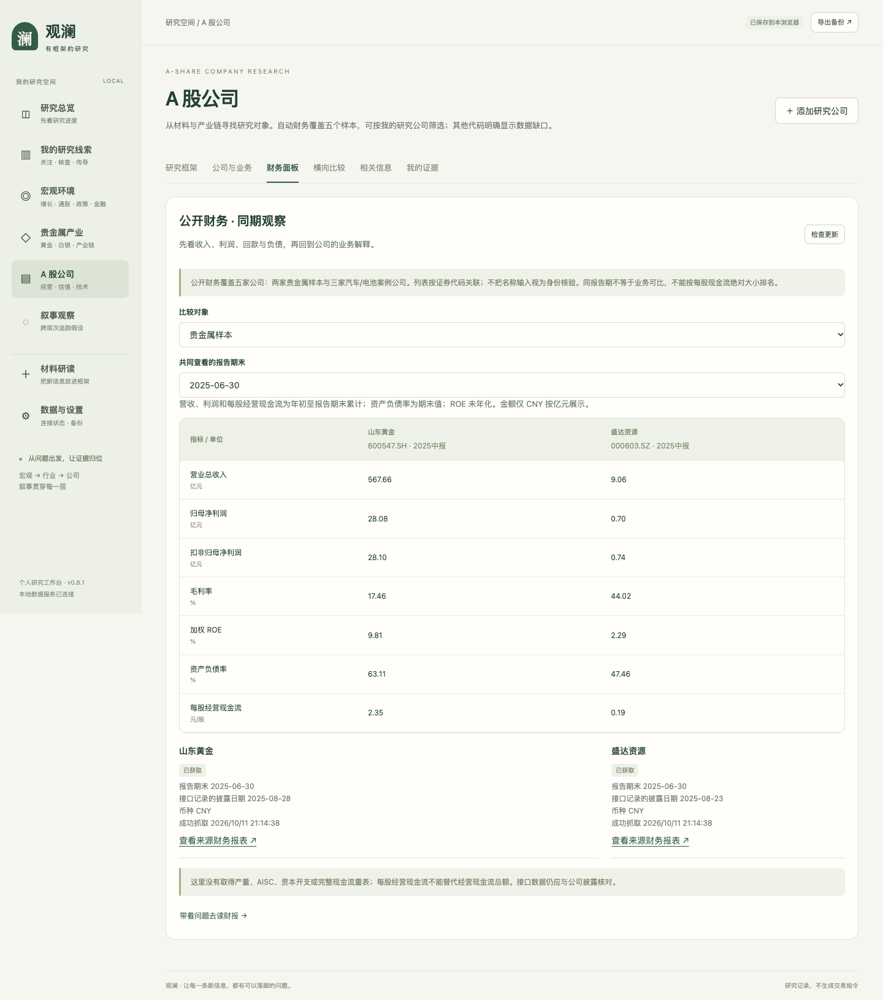
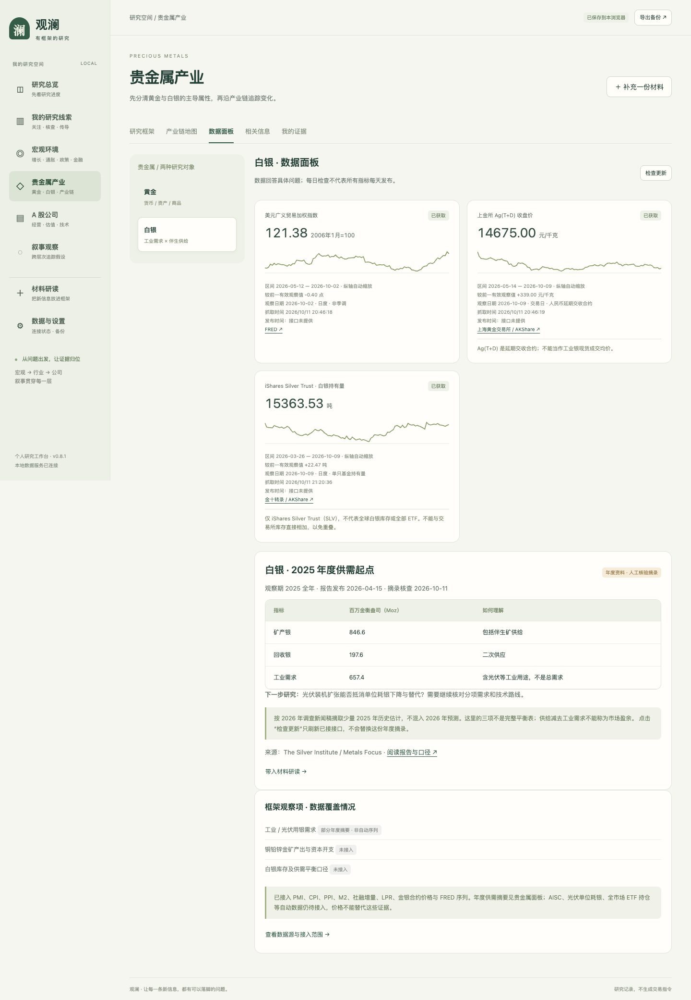

# 观澜使用说明书 · v0.5

适合有一些金融基础、希望把宏观—贵金属—公司研究串起来的人。工作台帮助保留证据、问题与判断变化；不会替你给股票排名或下单。

## 1. 打开后先做什么

直接打开 `prototype/观澜-可交互原型.html`，即可浏览带日期的公开快照，整理材料和保存研究。需要检查数据更新、调用自己配置的 AI 或计算价格指标时，双击 `prototype/启动原型.command`，使用固定地址 `http://127.0.0.1:8765`。

两种地址的浏览器记录彼此独立。迁移前到「数据与设置」导出备份，再到新地址导入合并。关闭服务后不再自动采集；重新启动才补查。数据快照不等于实时数据。

## 2. 三分钟了解产品

1. **宏观环境 → 货币与金融 → 数据面板**：查看利率、美元、融资指标，先读观察期和口径。社融来源较旧时有明确提示。
2. **贵金属产业 → 白银 → 数据面板**：上部看价格、单只基金持仓等序列，下部看年度供需摘要。不要把吨与百万金衡盎司混用。
3. **A 股公司 → 财务面板**：选择同一报告期，查看两个固定公司样本。不是自己的自选列表，也不按数据大小评优劣。
4. **叙事观察 → 方法与研究起点**：展开模板，看看某个解释成立需要哪些条件。预览不会自动成为个人观察。

## 3. 路线一：从数据发现问题，再保存证据

本轮实际走通的案例是白银年度摘要。摘要源于白银协会与 Metals Focus 的公开年度资料，保留来源链接，不是 AI 生成统计值。

1. 进入 **贵金属产业 → 白银 → 数据面板**，找到「2025 年度供需起点」。
2. 先读观察期、报告发布日和单位。矿产、回收和工业需求只是少量摘录，不能由这三项直接算市场盈余。
3. 点击 **带入材料研读**。系统复制摘要、来源和口径说明到草稿；这时尚未归档。若有旧草稿，会先询问是否替换，取消则保留旧草稿。
4. 点击 **下一步：拆解与归类**，选择含工业需求的原文段落。
5. 示例观点可写：“2025 年工业用银需求为 657.4 Moz；这是年度估计，不能推出光伏需求同比方向。”这是对口径的研究记录，不是买卖结论。
6. 归类选 **贵金属产业 / 白银**；验证问题可写：“光伏分项及单位耗银如何变化？”反证条件可写：“若报告修订，或光伏分项与总工业需求方向不同，应修订解释。”
7. 下一步检查观点、出处与归类，最后点 **确认归档**。回到白银「我的证据」查看，可定位原段落；关闭并重新打开后记录仍保留。
8. 后续读到新证据时点 **补充 / 修订**，写修改和理由，核对前后差异后确认。历史版本保留。

## 4. 路线二：带入自己的播客或文章

材料研读 → 新建材料 → 粘贴正文或导入 UTF-8 TXT/MD → 填标题、材料类型与来源链接 → 拆解与归类 → 确认归档。段落间留空行，便于定位。当前不自动抓取播客音频或公众号全文。

没有 API 也能手动完成。关键词只提供候选位置；需要你填写观点和验证条件。配置后点击「AI 辅助拆解」才发送当前材料与框架摘要给服务商；核对引文和建议后再归档。系统的引文校验不等于外部事实核查。真实模型调用尚未验收。

一份材料可归档多条观点，每条各自归类。不要把整篇复杂讨论只保存成一个无法验证的大结论。

## 5. 新闻如何用

在对应层次选择「相关信息」，按当前问题、本层全部或全部信息源筛选；也可选来源及标题关键词。没有结果时先检查过滤条件和源是否启用。

新闻卡展示发布时间和获取时间。相同日期、相同标题折叠，近似标题可能仍重复，转载不是独立证据。点击标题到来源阅读；有些接口只提供来源列表，会明确标注。

「记录阅读后的证据」仅带入标题和链接，你需补正文。公司新闻目前是两家固定样本，不随个人公司自动订阅。

## 6. 叙事如何持续追踪

从方法模板建立个人观察，或自行新建。填写假设、关联节点、预期基准、验证问题、反证条件和标题关键词。点击保存后才出现在「我的观察」。

模板观察包含里程碑。更新为支持、反证或延期时，必须补依据/理由；记录保留历史。关键词命中仅表示标题相关，不是结论被证实。可暂停、编辑主题或将匹配新闻标已读。

## 7. 公司、估值和技术指标

「财务面板」默认选择两家样本共同拥有的报告期。收入利润是年初以来累计，资产负债率是期末值，ROE 未年化。每股经营现金流不是现金流总额；没有 AISC、产量和完整资本开支。

「公司与业务」可以手动添加自己的对象，写清代码、产业链角色和理由；这不会触发自动财务抓取。记录估值时保留日期、币种、报告期和来源，不同口径不宜直接比较。

导入价格使用 UTF-8 CSV，列名 `date,close`，明确复权、币种及来源。本地 TA-Lib 计算 MA20、RSI14、MACD；样本不足显示空值。日期重复、未来日期、非正价格会被拒绝。暂未自动接行情。

## 8. 数据失败和记录恢复

- **数据较旧**：看观察期，而不是只看成功抓取时间；不要据此判断市场今天发生了什么。
- **抓取失败**：设置页查看原因；有缓存时继续显示旧值。年度摘要是人工版本，刷新接口不会更新它。
- **AI 不可用**：按手动流程继续；密钥只在本地 `.env` 配置，不粘贴到聊天、网页或备份。
- **换浏览器/地址**：先导出 JSON，再导入合并；相同 ID 保留当前记录，不覆盖。导出含材料正文和草稿，需要自己保管。
- **网页保存异常**：先导出备份；不要通过清理浏览器数据来“修复”，以免丢失本地记录。

## 9. 本说明书的验收边界

数据到归档的新路径已用真实公开摘要执行；新闻、叙事、修订、备份、价格计算等既有功能有分项测试。尚未让外部用户独立跑完全套任务，尚未验收真实模型，也没有线上服务链接。因此本文件是可使用的首版说明书，不是“全部功能已完成外部验收”的声明。
