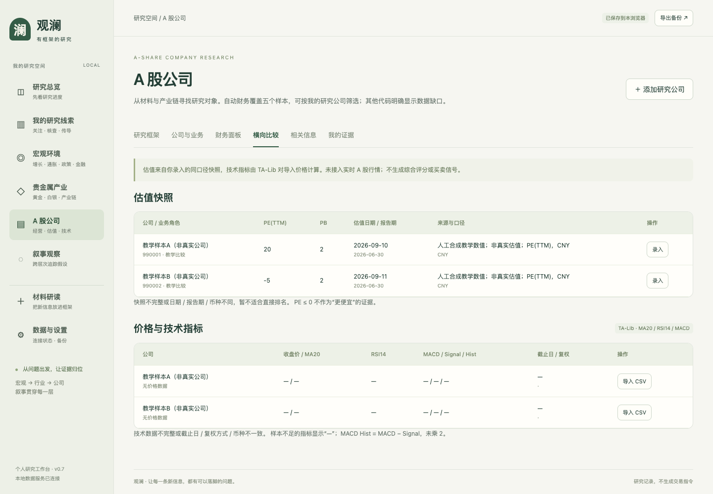
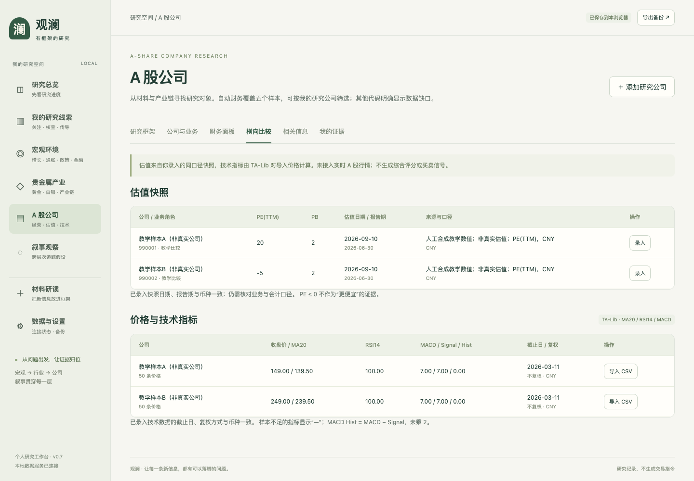
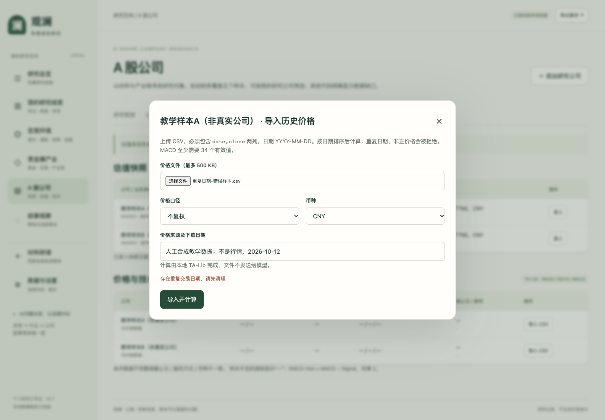
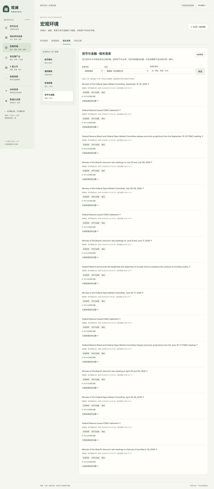
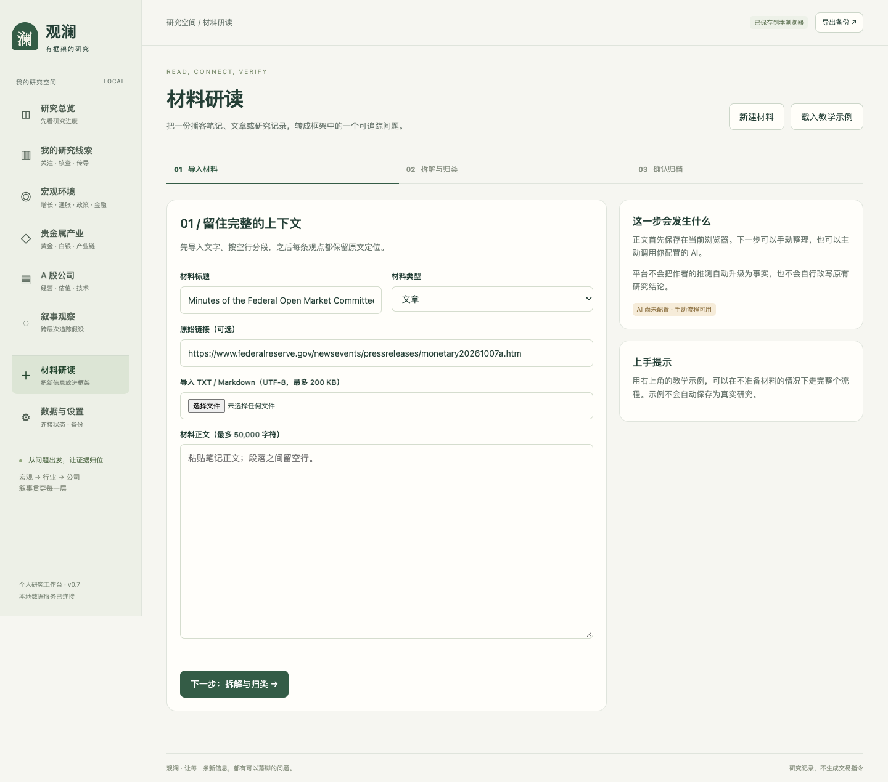
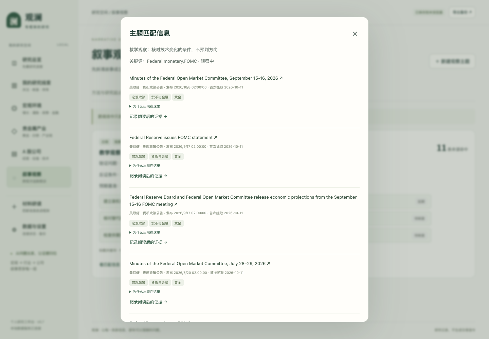
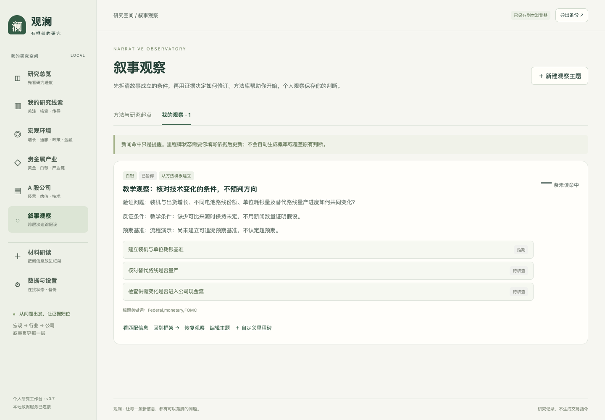
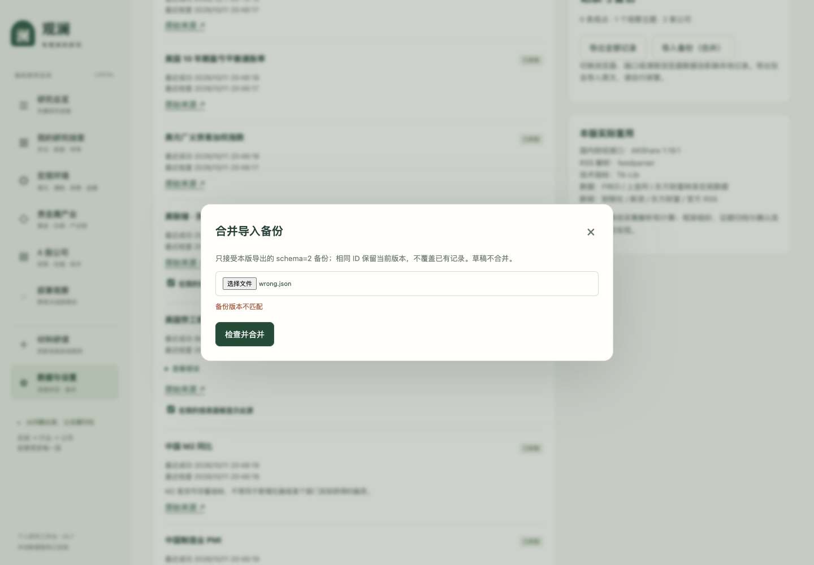

# 观澜全功能使用说明书

适用产品：v0.7本地版｜整理与验收：2026-10-12。

观澜服务于有一定金融基础、经常接触深度资讯但研究记录较零散的人。使用顺序是：**找到问题 → 保存有出处的观点 → 连接框架与公司 → 核对证据 → 持续观察和修订**。宏观、贵金属、公司是研究层次；叙事是贯穿这些层次的待验证解释。

这是一份综合试用说明书，汇总已验证的操作；不代表真实模型、全市场数据或云端部署均已完成。历史说明书保留在[文档索引](文档索引.md)。

## 1. 启动与数据保存

双击项目中的 `prototype/启动原型.command`，浏览器访问 `http://127.0.0.1:8765`。需要Python依赖的新环境按[README](../README.md)安装。保持本地服务运行，才能检查公开数据更新、计算技术指标和调用配置好的模型。

直接打开 `prototype/观澜-可交互原型.html` 也可以查看带日期的公开快照、手动整理材料与保存记录，但不能刷新数据、计算CSV或调用模型。独立HTML与本地服务地址的记录不共享。

研究记录保存在当前浏览器中，不是云端账户。换浏览器、地址或电脑前先点“导出备份”，再到新环境的“数据与设置 → 导入备份（合并）”。备份包含导入原文和草稿，请保留在自己的存储中。

## 2. 根据当下需要选择入口

| 想做的事        | 入口                         | 完成标志                |
| ----------- | -------------------------- | ------------------- |
| 看今天有什么值得研究  | 宏观 / 贵金属 / 公司 → 数据或相关信息    | 找到明确的问题，并知道数据观察期与来源 |
| 留下播客中的观点    | 材料研读                       | 已确认归档，有原文定位、问题与反证条件 |
| 优先看与自己有关的记录 | 我的研究线索                     | 设置关注词，保留而不删除其他线索    |
| 想知道影响什么公司   | 观点 → 打开研究链路                | 保存有条件的传导路径及关联公司理由   |
| 检查数字和解释     | 研究链路 → 核查项                 | 留下期间、口径、来源和核查状态     |
| 做公司比较       | 公司与业务 → 查看财务 / 记录估值 / 导入价格 | 同期、同口径比较；缺失明确留空     |
| 以后继续观察      | 叙事观察 → 我的观察                | 有验证条件、里程碑和后续证据记录    |

如果没有明确标的，可以先完成材料归档和观察，不必为走完流程随便加入公司。

## 3. 阅读数据、框架与产业链

进入宏观页面，从经济增长、通胀、政策或货币金融问题开始。每个节点的研究框架解释需要观察什么；数据面板标明哪些已接入，未接入的指标不显示虚构数值。

进入贵金属页面选择黄金或白银，可查看相应价格、单只ETF持有量、年度供需摘要与产业链角色。黄金、白银合约单位不同；单只基金持有量不等于全部市场持仓。产业链帮助确定参与角色，不能直接推出受益公司。

先读观察期、单位、来源与最后成功抓取时间。新近抓取的旧数据仍是旧数据。出现抓取失败时，已有缓存保留并标记状态；没有缓存则显示缺失。“检查更新”只刷新已配置来源，人工年度摘要不会随接口自动更新。

年度摘要的“带入材料研读”会填入有来源的草稿，不直接归档。已有草稿时先确认是否替换，取消则保持原草稿。完整实例见[v0.5说明书的数据到归档路径](使用说明书.md)。

## 4. 从材料到研究记录

1. 在材料研读中填写标题、类型和可选来源链接，粘贴正文或导入UTF-8 TXT/Markdown。最多50,000字符、文件200 KB。用空行分段。
2. 进入“拆解与归类”，选择依据所在段落。填写一条观点、框架节点、下一步验证问题、什么情况需要重新判断。
3. 检查归档预览。如需同时观察，勾选追踪并填新闻标题关键词。
4. 确认后到框架的“我的证据”查看，或“继续整理同一材料”保存下一条观点。
5. 在“我的研究线索”设置关注关键词。当前按关键词和已关联公司排序，不读取真实持仓，也不是语义推荐。

来源保留完整上下文和段落；纪要标题中的时间戳可识别、可修正，但不等于音频时间点已经回听核验。关键词辅助归类不是AI分析。导入源文本只作为研究内容，不作为平台执行指令。

完整真实材料案例：[十分吸引EP.02四条使用路径](场景式说明书-十分吸引EP02.md)。其中六条观点进入不同研究问题，保留三家公司、八项核查和三个观察主题。

## 5. 连接传导路径、公司与核查

从观点卡“打开研究链路”，逐行写传导环节，并保留条件，例如成本变化、合同及库存滞后、议价能力、利润与回款。路径是研究假设，不是已证明因果。

“从这条观点添加公司”要求名称、六位代码、产业位置、研究理由和待验证问题；已有公司用下拉框关联。公司列表的“为什么研究它”可以返回原观点。输入名称与代码不是证券身份认证。

每项核查填写材料值、单位、观察期、来源与限制。可选已接序列后点“按此期间对照缓存”；没有同期间数据会明确提示，不能拿最新值替代旧观点的历史数值。一致只代表缓存数值对得上，仍需核指标定义。不同也可能来自盘中/日终、时间窗或取整，并不自动判错。

“补充核查依据”修改同一项，并保留旧状态与依据。具体操作见[公司财务与核查修订](公司财务与核查修订-v0.7.md)。

## 6. 公司财务、估值与技术指标

### 6.1 已接公开财务

“公司与业务 → 查看财务”会按保存的代码切换到个人公司范围。当前支持山东黄金、盛达资源、宁德时代、比亚迪、亿纬锂能五个样本。可切换贵金属样本、个人公司、全部样本和报告期。不支持的代码列明缺口；不存在的季度显示“—”。

展示营收、归母净利润、扣非净利润、毛利率、ROE、资产负债率、每股经营现金流。累计值与期末值不同；同一期也不保证业务可比。分部业务、AISC、产销量、资本开支和完整现金流仍需原始资料。

### 6.2 手动录入估值快照

在公司旁点击“记录估值”，填PE(TTM)和/或PB、估值日期、财报截止期、币种、来源和口径说明。至少填一个倍数；报告期不能晚于估值日期，日期不能在未来。保存后进入“横向比较”。修改快照会保留记录历史，但当前公司页面没有单独的估值历史浏览入口；历史在完整备份中保留。

本次用两家**非真实公司的教学样本**验证：A的PE为20，B为−5，PB均为2，报告期均为2026-06-30。先令估值日期分别为9月10日和11日，页面提示日期不同、不适合直接比较；把B改成9月10日后，提示日期、报告期与币种一致。负PE仍不能作为“更便宜”的依据。

此处数字只验证产品操作，不是现实估值数据。来源应在真实使用时填写提供倍数的具体机构、页面和日期，不能照抄教学来源。

### 6.3 导入价格并计算

1. 准备含 `date,close` 两列的UTF-8 CSV，日期格式YYYY-MM-DD。最多500 KB、1–5000行。
2. 点击“导入价格”，选择文件、前复权/后复权/不复权，填写来源及下载日期。
3. 点击“导入并计算”。本地TA-Lib计算MA20、RSI14、MACD，页面保留截止日期、复权口径、币种与样本量。选择复权标签不会替原始价格进行复权，必须与文件实际口径一致。
4. 比较前检查截止日、复权与币种。页面未确认交易日是否完整，也没有校验供应商价格是否正确。技术指标不输出买卖信号。

可下载[教学样本A](../examples/教学样本A-合成价格.csv)和[教学样本B](../examples/教学样本B-合成价格.csv)，按[教学输入说明](../examples/README.md)操作。它们是递增合成序列，不是股票行情。A末值149、MA20为139.5、RSI14为100；B末值249、MA20为239.5。MACD Hist按MACD−Signal展示，没有乘2。

只有一条有效价格时可以保存，但MA20、RSI14、MACD因样本不足留空。MA20至少20条，RSI14通常至少15条，当前MACD默认参数至少34条；不对空值补0。

[重复日期错误文件](../examples/重复日期-错误样本.csv)会被拒绝。第一次错误导入不生成结果；已经成功导入后再提交错误文件，保留之前的结果。修改CSV、删除重复日期后重试，不能把错误提示当成已完成计算。

## 7. 新闻怎样进入日常研究

从宏观、贵金属或公司页面进入“相关信息”，选择当前问题、本层或全部范围，再选来源与标题关键词并应用。没有结果先检查过滤条件和来源开关。

本次实操选“全部范围 → 美联储来源”，展示公开缓存中的公告。新闻的发布时间与获取时间分开；页面不是实时全网检索。公司新闻仍是两家贵金属样本，尚未随个人公司自动扩展。

点标题去原始来源阅读。“记录阅读后的证据”仅把标题和链接带入研读，正文留空，等待你填写有权使用的原文摘录或自己的笔记。它不自动抓取文章全文，也不凭标题生成分析。

补正文后按第4节归档；纯标题不足以形成完整证据。部分新闻只能链接到来源列表，会说明链接类型。同日相同标题可折叠，转载仍不等于多份独立证据。

## 8. 叙事模板、观察与提醒

在“方法与研究起点”查看四个模板。打开模板只是预览，不会订阅。点“用它建立观察”，修改假设、节点、验证问题、反证条件、预期基准和关键词，保存后进入“我的观察”，继承对应里程碑。

本次用技术变化模板建立明确标注的教学观察，示范延后核验：更新里程碑为“延期”但不填依据会报错；补上缺少数据的理由后才能保存。支持、反证、延期是用户对证据的判断，不是平台自动验证。

个人主题也能自行新增行业/叙事里程碑，填写判定规则和复核日。初始规则与后续证据分开保留。待核查事项到期时，只在页面中提示复核，不发送邮件、系统通知，也不自动判定阈值突破。

“看匹配信息”匹配已接源的标题。实操使用Federal、monetary、FOMC作为教学关键词，验证公开缓存的匹配与已读机制；这不表示这些公告支持技术变化假设。

“将这些条目标为已读”后，当前命中未读数变为0；之后新增条目仍可能产生未读。暂停后不再显示主动观察计数，但可以看已有缓存；编辑主题不会清空原里程碑或已读记录，恢复后继续观察。

观点更新与主题更新是两项独立操作。修订观点需要写理由、查看前后差异并确认；不能因为观点改了就静默覆盖原观察假设。

## 9. 数据开关、备份与失败恢复

| 情况           | 操作                | 实际行为                        |
| ------------ | ----------------- | --------------------------- |
| 不希望看到某来源     | 设置页取消来源勾选         | 信息面板过滤该来源；不是删除研究，也不等于停止后端采集 |
| 查不到某条新闻      | 检查范围、来源、标题关键词     | 缓存有限；无匹配不代表全网不存在相关信息        |
| 导入错误价格       | 修正CSV后重新提交        | 原有成功结果保留                    |
| 导入错误备份       | 使用正确schema与完整备份   | 报错，不修改现有记录                  |
| 重复导入同一备份     | 可再次合并             | 同ID保留当前记录，不重复添加；不是按版本自动择新   |
| 切换浏览器或独立HTML | 导出JSON，再在新环境合并    | 公司、估值、价格、观察与历史可迁移           |
| 缓存过旧或抓取失败    | 检查观察期、状态和来源；需要时重试 | 成功抓取时间不能替代观察日期              |
| 浏览器无法保存      | 先导出备份，再检查存储空间     | 不要先清除浏览器数据                  |

本次错误schema备份被拒绝，原有数据保持一致；正确教学备份导入新浏览器两次，仍只有两家公司和一个观察，MA20结果保持139.5，刷新后仍在。

完整备份是私人数据文件，不作为公开案例包。公开仓库可保留教学CSV、流程截图与说明书；私人播客全文和密钥不放入公开文件。

## 10. AI辅助研读怎么使用、哪里还没验证

按[本地API配置](本地API配置.md)在本机配置兼容接口，重启服务。在研读第二步主动点“AI辅助拆解”才发送当前材料与框架摘要；不是发送整个研究库。取得候选观点后，逐条核对段落引用、归属问题和验证条件，再确认归档。

未配置时按钮不可用，仍可手动完成。模拟接口已验证：分析期间若改了材料，迟到的旧结果不会覆盖新草稿；建议返回不等于已归档；编造原文引用、错误段落和未知节点会被后端拒绝。

**这些测试没有调用真实模型。** 模型效果、供应商兼容性、延迟、费用与真实材料上的误判仍待配置后验收。引文确实存在于材料，也不证明材料中的事实为真。

## 11. 功能覆盖与仍未完成事项

| 功能              | 已有验收依据                | 覆盖边界                |
| --------------- | --------------------- | ------------------- |
| 宏观/金银数据、年度摘要→归档 | v0.5真实公开数据流程          | 非金融终端完整覆盖，部分来源旧或失败  |
| 产业链角色、框架节点与证据   | v0.5操作与v0.6案例         | 人工判断，没有自动证明因果       |
| 材料导入、时间戳、关注排序   | v0.6真实播客完整流程          | 未验证原音频；关键词非语义推荐     |
| 路径、公司来源、八项核查、版本 | v0.6、v0.7真实案例与恢复测试    | 部分数字仍待核实，不能算全篇事实核验  |
| 五家公司财务与范围选择     | v0.7真实公开接口、同期比较       | 非全市场；分部与完整现金流未接入    |
| 估值、技术指标及错误输入    | 本轮教学样本、真实TA-Lib计算     | 没有用真实股票行情验收，也未自动接行情 |
| 新闻筛选、进入研读、源开关   | 本轮公开缓存操作              | 正文需用户补充，未订阅所有播客/公众号 |
| 模板采用、延期、已读、暂停恢复 | 本轮UI实操                | 状态由用户判断，没有站外提醒      |
| 备份拒错、合并去重、刷新迁移  | 本轮隔离浏览器实操             | 无云端账户同步；冲突按同ID保留当前值 |
| AI候选、迟到结果、引用校验  | 模拟接口UI测试与后端契约         | 真实模型效果尚未验收          |
| 旧版记录保留、文本转义、移动端 | 既有原型测试；v0.6/v0.7移动端回归 | 尚无外部用户可用性研究         |
| 部署与运行维护         | 本地服务、独立HTML           | 尚未公开部署，无全天候云端任务     |

后续优先级：真实模型研读验收 → 真实行情输入与字段口径核查 → 部署环境与访问、费用、数据隔离设计 → 外部用户独立操作测试。每项完成后补独立记录，再更新本说明书；不把“已有按钮”当成“已完成端到端验证”。
