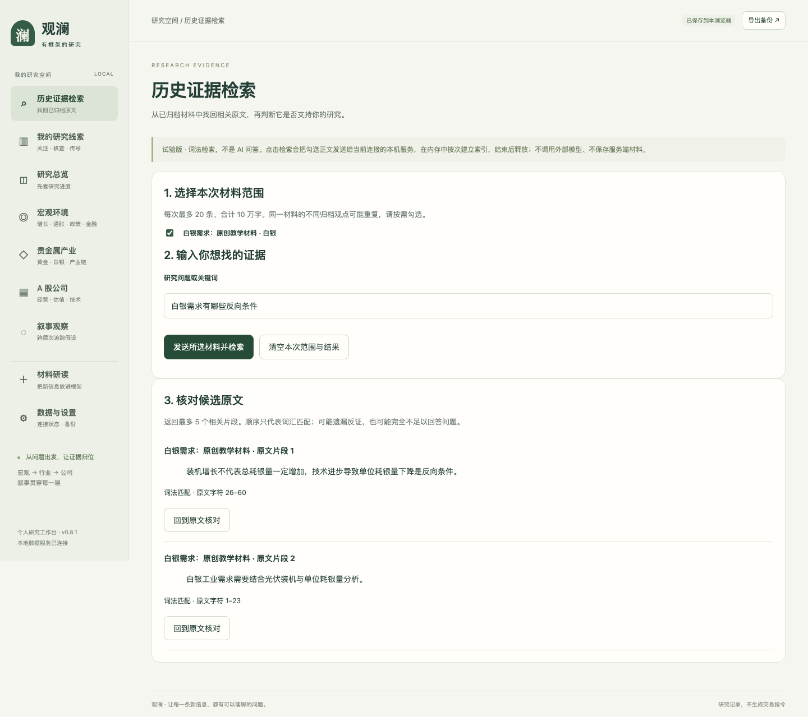
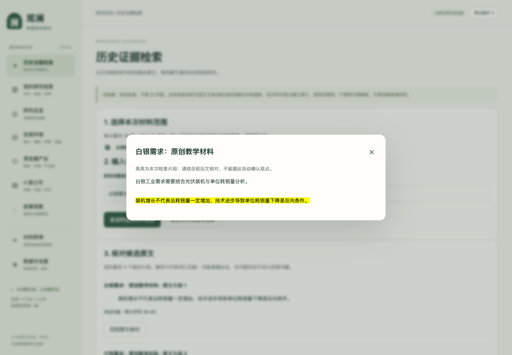

# 历史证据检索 · 使用说明 v0.1

日期：2026-10-25。这是开发分支新增的本机试验功能，尚未发布至线上。原有说明书保留，本说明作为增量补充。

## 解决什么问题

听完多份材料并归档后，用户可能记得某个判断，却忘了它来自哪里。此页面用于在自己选择的已归档原文中找回候选段落，并回到完整上下文核对。它不生成答案、不自动修改研究观点，也不保证找全反证。

## 从归档到原文核对

1. 启动本地服务，确认页面左下角显示已连接。独立 HTML 离线模式只能查看入口，不能执行检索。
2. 到“材料研读”导入文字，填写观点、验证问题与重新判断的条件，确认归档。也可以从首页的原创教学示例开始。未归档草稿不进入检索范围。
3. 打开左侧“历史证据检索”，勾选这次要查的材料。每次最多 20 条，正文合计不超过 10 万字；同一材料归档多个观点可能出现多条，按需选择。
4. 输入研究问题或关键词，点击“发送所选材料并检索”。这是明确的数据处理动作：选中正文发送给当前连接的本机服务，在内存中临时建立词法索引，处理完成后关闭。正文不进入服务端持久数据库，不调用外部模型。
5. 查看最多 5 个候选片段。点击“回到原文核对”，在完整材料中查看高亮位置及前后文。字符位置按 Unicode 字符计算，含 emoji 的正文也会校验引用位置。
6. 核对后，可回到原有研究流程人工修订观点。本页面不会替用户确认观点、增加持仓或修改观察事项。
7. 点击“清空本次范围与结果”，清除当前页面的选择、问题与候选；已归档研究记录不会被删除。页面刷新也不保留本次检索状态。

教学问题示例：“白银需求有哪些反向条件？”可用下面的原创内容归档后试用：

> 白银工业需求需要结合光伏装机与单位耗银量分析。
>
> 装机增长不代表总耗银量一定增加，技术进步导致单位耗银量下降是反向条件。

实际页面（仅使用上述原创教学内容）：

## 结果变化与异常

| 情况 | 页面行为 |
| --- | --- |
| 没选材料或没填问题 | 提示补充，不发起检索 |
| 超过材料数或字数限制 | 拒绝本次检索，请缩小范围 |
| 没有匹配结果 | 提示改用关键词或阅读原文，不宣称材料没有相关观点 |
| 等待期间改问题、改范围或清空 | 忽略旧请求返回的结果 |
| 当前浏览器内材料被修改或删除 | 旧结果失效，需要重新检索 |
| 回跳时原文或字符位置不符 | 不展示为有效引用，要求重新检索 |
| 未连接服务、接口出错或限流 | 显示实际错误，不显示成功结果 |

当前浏览器状态是核对依据；尚未实现多个标签页间实时协同。跨标签页修改后应刷新当前页再检索。

## 技术范围与边界

本页面接入的是中文双字片段 BM25 词法检索，正文按非空行识别段落，再拆为最多 600 字符的块；只去掉段落两端空白，保留正文偏移，不摘要、不截掉正文内容。600 字符不是向量模型的 token 上限。向量与重排已经在独立实验中运行，但尚未接入此页面。

通用分块器另支持 tokenizer 计数。本机使用缓存的 BGE tokenizer 对 15,300 字符原创长文验证，得到 19 块，每块不超过 512 tokens；各块与原文字位置一致，可还原去掉边缘空白后的段落。该验证不等于长文问答质量通过，也不包含跨块上下文重叠。

接口 `/api/retrieve` 继承已有登录、Host、Origin 与 600 KB 请求体检查，另限制每分钟 20 次、本次材料数及字数，并仅接受回环地址连接。每次新建内存索引，请求间不保留语料，因此没有“旧服务器索引忘删”的持久状态。未来如改为持久向量索引，仍需重新实现版本同步、删除与授权规则。

相关片段不等于充分证据。不能把候选数量、匹配顺序或引用存在当成观点为真的证明。实验对比与边界见 [检索方案实验 v0.2](retrieval-experiment-v0.2.md)。

## 验证记录

自动浏览器流程覆盖：教学示例归档 → 勾选 → 调用真实本地接口 → 候选原文 → 高亮回跳 → 清空；另检查 Unicode 偏移、材料变更、请求期间改问题和离线禁用。使用原创教学数据、新浏览器上下文，不读取用户日常存储。它属于工程验证，不是人工盲评或真人用户试用。

最终统一验收：79 项后端、19 项界面通过；证据保存在本机 `data/verification/run-2h8xlxs5/`。主负责人另运行真实本地接口的教学场景并查看上述两张截图。首轮失败及修复说明见 [工程质量记录](quality-harness.md)。
