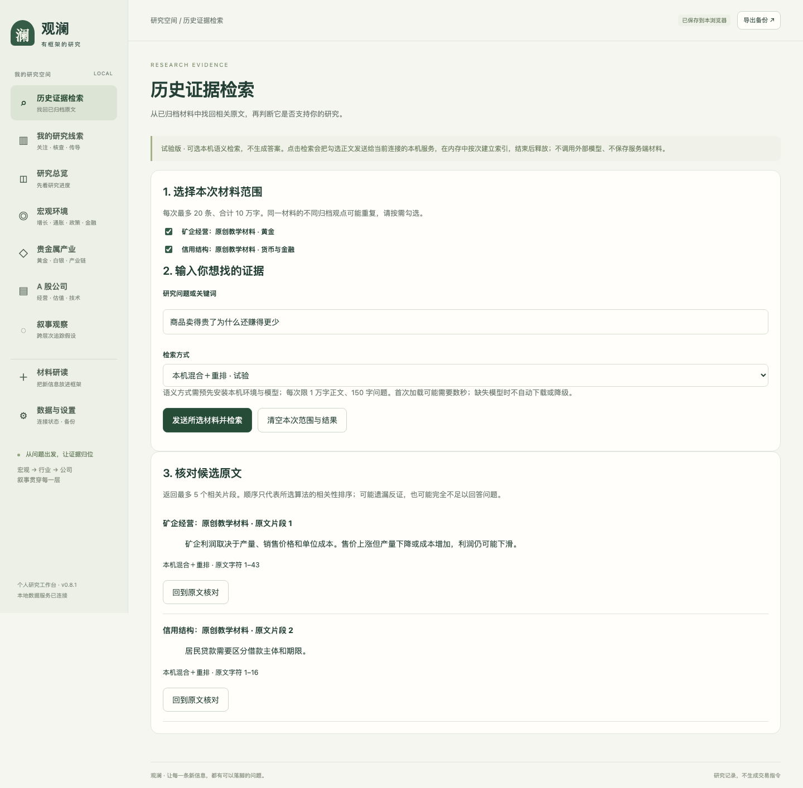

# 历史证据检索 · 使用说明 v0.2

日期：2026-10-25。开发分支新增本机向量检索和混合重排选项；不生成答案。此前 [v0.1 说明](历史证据检索-使用说明-v0.1.md) 保留，选择材料、回跳核对、清空和失效规则沿用。

后续验收补充：结果区域明确显示“证据是否足以回答，尚未判断”，不会按高分标为已验证。新材料的实际结果与遗漏见 [检索验收与证据边界](检索验收与证据边界-v0.1.md)。

## 新增操作

1. 在“历史证据检索”勾选已归档材料、输入问题。
2. 从“检索方式”选择：词法检索（默认）、本机语义检索、或本机混合＋重排。词法适合明确关键词；语义与重排可尝试找回换一种说法表达的内容，但仍需核对原文。
3. 点击“发送所选材料并检索”。语义方式每次限 1 万字正文、150 字问题和最多 100 块；本机最多同时处理一个语义请求，超过限制会明确提示。
4. 等待本机模型加载与检索。结果卡显示实际执行的方法，再点击“回到原文核对”。切换方式会清空旧结果，不会把旧算法的结果显示为新算法结果。
5. 若环境或缓存缺失，页面报错，不会自动下载、调用云端或降级到词法。可以手动选回词法检索。

切换方式或改问题会忽略正在返回的旧结果，但旧本机计算可能仍需数秒结束；此时新请求可能提示模型忙，请稍后重试。单次工作进程超时上限为 38 秒。



截图使用原创教学材料：“矿企利润取决于产量、销售价格和单位成本。售价上涨但产量下降或成本增加，利润仍可能下滑。”用“商品卖得贵了为什么还赚得更少”提问，首条找到该原文。第二条可能仍是弱相关材料：当前没有经过验证的相关性阈值，更没有证据充分性判定，不能把返回片段都当成支持结论的证据。

## 本机准备

产品服务继续使用原 `.venv`。可选模型依赖放入独立 `.venv-rag`；也可通过服务端环境变量 `GUANLAN_RAG_PYTHON` 指定已配置的 Python。不要把解释器路径、模型路径或密钥作为网页参数传入。

```sh
python3 -m venv .venv-rag
.venv-rag/bin/python -m pip install -r requirements-rag.txt
# 首次准备会联网下载模型，同时跑公开原创样本对比；不是页面请求过程的一部分。
.venv-rag/bin/python scripts/compare-retrieval.py --vector --revision 7999e1d3359715c523056ef9478215996d62a620 --rerank --reranker-revision 1427fd652930e4ba29e8149678df786c240d8825
```

实际页面请求只读固定修订的本机缓存，设置 Hugging Face / Transformers 离线模式和 `local_files_only`，不访问推理 API。缓存不全需要先完成准备。模型和第三方依赖遵循各自许可，版本与许可见 [实验 v0.2](retrieval-experiment-v0.2.md)。直接依赖版本已记录，尚无跨平台全量锁定。

## 数据与运行边界

- 正文经同源接口发送到本机服务，再通过标准输入交给隔离工作进程；不放到命令行参数或持久文件。
- 每次加载模型、建立临时索引、返回最多 5 条候选，进程随后退出。索引和向量不跨请求复用。
- 向量采用 BGE tokenizer 每块最多 384 tokens，保留原文字符位置；不摘要、不静默截断。混合重排先融合词法与向量前 10 条，再对最多 10 对问题/段落评分。重排输入超过 512 tokens 时拒绝处理。
- 服务端错误不回显第三方堆栈或正文。超时会终止工作进程并释放并发锁。默认词法完全不依赖模型环境。
- 此方式优先保证按次释放与依赖隔离，代价是重复加载模型。本机教学页面实测约 3.8 秒（向量）、4.3 秒（混合重排）；另外一次直接接口调用约 4–9 秒。不是纯排序耗时，也不是性能承诺。

## 本轮验收

统一工程验收 **当时的 84 项后端、21 项界面通过**。常规验收使用模拟工作进程验证缺失环境、超时、并发、超限与不降级行为，不下载或运行模型。

另由主负责人运行真实本机模型的页面流程：选材料 → 切换向量/重排 → 调用真实接口 → 检查首条来源和实际方法 → 原文高亮 → 清空，已有研究记录数量不变；截图已查看。运行记录在本机忽略目录 `data/retrieval-ui/semantic-flow.json` 与 `data/retrieval-comparison/product-semantic-check.json`。无付费 API、私人材料或真人试用。

真实长文本机械检查另使用重复的原创背景句加现金流目标句，核对目标片段与字符偏移；这不是独立质量评测集，不能作为投研检索准确率。仍需独立多材料评测、证据不足处理和跨块上下文验证后，再讨论生成式回答。
