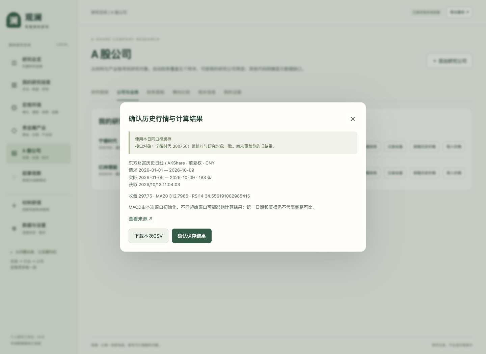
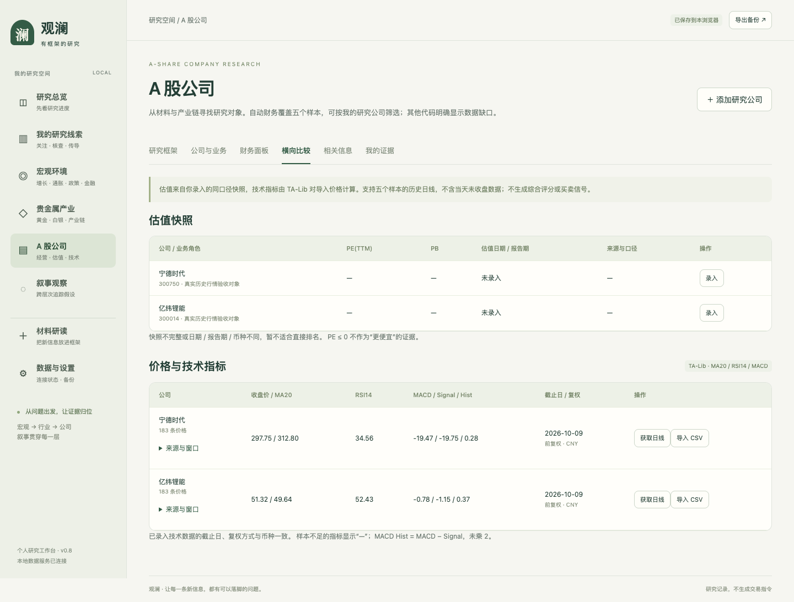

# 真实历史行情：获取、预览、保存与复算

产品版本：v0.8｜验收日期：2026-10-12。

本篇接续[v0.7全功能说明书](全功能使用说明书-v0.7.md)。此前技术指标使用合成教学数据验证，本轮使用东方财富日线，经AKShare读取，再由本地TA-Lib计算。前复权价格可能随后续公司行动变化，不是当时可见价格的固定历史快照，不用于证明无前视偏差的回测。

## 本次完成与未完成

宁德时代300750、亿纬锂能300014分别取得2026-01-01至2026-10-09区间的183条有效日线，实际末日为2026-10-09。工作进程完成真实取数并保存带来源的本地缓存；浏览器端使用同日同口径真实缓存完成确认、保存、导出及复算，不是模拟价格响应。

比亚迪002594、山东黄金600547的同类请求在本轮反复连接失败，尚未取得该窗口数据；盛达资源000603未在本轮实测。接口允许五个既有样本代码，但不能描述为五家公司行情都已稳定接通。单次失败也不表示证券没有数据。

## 操作步骤

1. 启动本地服务，在“公司与业务”中添加研究对象。已有对象无需重复添加。
2. 点击“获取历史价格”；也可在横向比较表中点“获取日线”。
3. 选择开始日、结束日和前复权／后复权／不复权。区间最多730天，结束日必须早于今天，避免未收盘行情。
4. 点击“获取并预览”。默认复用本日同代码、同区间、同复权缓存；勾选“尝试更新”才跳过本日缓存直接请求。只有返回的交易日进入计算，不插补休市和停牌日期。
5. 在预览中核对接口对象、代码、来源、币种、请求窗口、实际窗口、样本数和获取时间。取消只关闭预览，不修改研究公司的技术结果。
6. 可以先下载本次CSV。确认无误后点击“确认保存结果”，才更新公司的技术记录，旧结果进入历史备份。
7. 横向比较表中的“来源与窗口”可查看已保存依据。同截止日、同复权、同币种仍不足以证明业务或完整价格序列可比。

每次计算都使用请求窗口全部有效价格；页面结果中的趋势点只保留末100条。MACD受初始化窗口影响，比较时也应检查起始窗口。价格单位CNY、复权口径与来源共同保存。

## 缓存与失败的区别

| 页面提示 | 含义 | 用户应检查 |
|---|---|---|
| 本次获取成功 | 此次向公开源取数成功 | 实际末日和来源，而不只看获取时间 |
| 使用本日同口径缓存 | 本地已有当日取得的相同请求结果 | 获取时间；需要时主动尝试更新 |
| 更新失败，使用旧缓存 | 更新失败，但本地有完全相同代码、区间、复权的旧数据 | 原获取时间；不要把旧缓存当成刚刷新的行情 |
| 连接失败且没有缓存 | 没有可展示的新结果 | 原研究记录不变；稍后重试或导入有来源的CSV |

连接异常最多重试一次，每次请求12秒上限，外层工作进程40秒上限。若冷启动依赖加载耗时，整体仍可能超时。失败原因会提示，不通过补0或合成数据制造结果。

本轮直接取数及部分HTTP调用成功，但部分浏览器触发的新取请求出现代理连接错误，原因尚未充分定位。缓存使已成功取得的数据可复用；它没有证明在线刷新已经稳定。后续仍需在部署环境验证连通性与覆盖范围。

## 实际验收

- 在研究记录为空时预览真实行情，确认前没有写入技术结果；关闭预览后仍没有写入。
- 保存后保留来源、复权与获取时间，刷新页面结果仍在。
- 将真实CSV最后20条收盘价独立求平均，与TA-Lib的MA20比较，一致。
- 下载本次真实CSV，再通过原有“导入价格”入口复算，MA20与直接获取流程一致。这里选择的复权标签必须匹配文件实际口径，标签不会帮文件重新复权。
- 输入未来结束日被拒绝，已有成功结果不改变。
- 缓存复用与强制更新失败回退通过后端契约测试；回退保留原始获取时间，不伪装成新数据。
- 390px宽度下无页面横向溢出。

真实CSV、完整验收结果和缓存仅存本机`data/`，公开文档展示必要截图与方法。此步骤验证数据流程，不构成公司比较结论。
